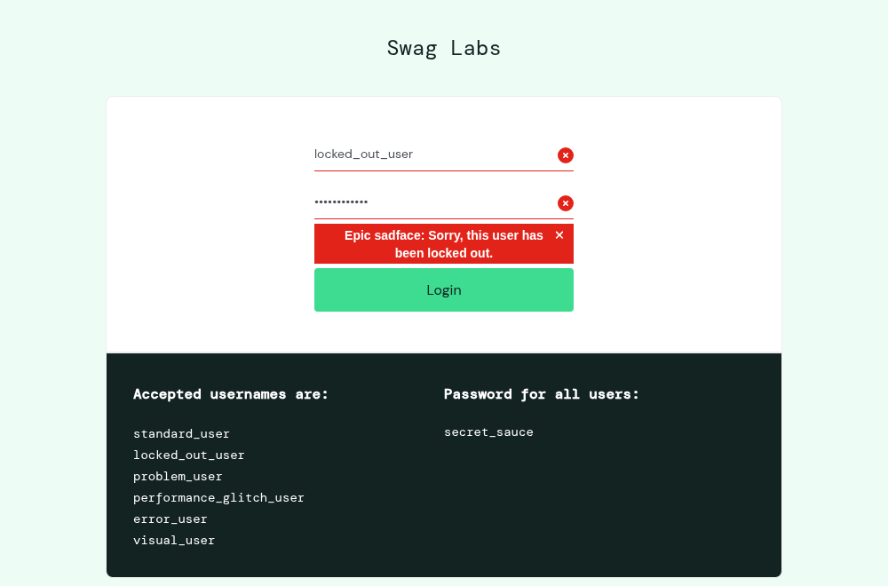
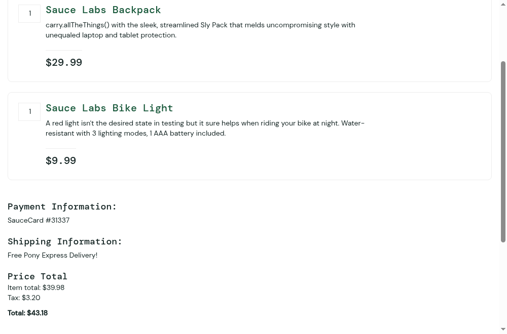
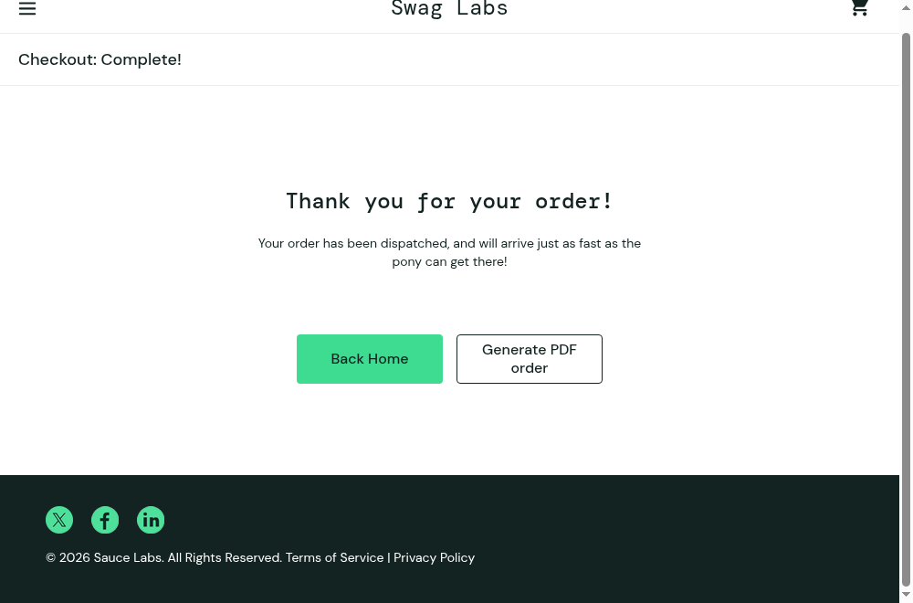

# Automação Web com Cypress

Este módulo contém testes automatizados de interface para o SauceDemo. Os cenários cobrem uma tentativa de login com usuário bloqueado e a conclusão de uma compra com dois produtos.

O [plano de testes do portfólio](../01-testes-manuais-e-bdd/plano-de-testes.md) reúne a cobertura manual, BDD, API e bug reports. O [plano de automação](plano-de-automacao.md) descreve o que a suíte cobre, como executar os testes e os limites das validações realizadas.

## Requisitos

- Node.js 22.x, 24.x ou 26.x em diante, compatível com Cypress 16.3.0
- Um navegador instalado: Google Chrome para o comando padrão, ou Edge, Firefox ou Chromium como alternativa

## Como executar

Dentro da pasta `04-automacao-cypress`:

```bash
npm ci
npx cypress verify
npm test
```

O `npm test` executa `cypress run --browser chrome`, em modo headless. Os comandos são os mesmos no Windows, no macOS e no Linux.

Se o Google Chrome não estiver instalado, escolha outro navegador no próprio comando:

```bash
npm test -- --browser edge
npm test -- --browser firefox
npm test -- --browser chromium
```

Também é possível abrir o Cypress com `npm run cy:open` e escolher o navegador na tela inicial. Para ver os passos na janela do navegador durante a execução, use `npm test -- --headed`.

O comando padrão indica um navegador porque, no Cypress 16.3.0, o `cy.screenshot()` falha no Electron, o navegador embutido no Cypress ([issue 35508](https://github.com/cypress-io/cypress/issues/35508)). Os specs usam capturas de tela como evidência, então sem um navegador indicado os dois testes falhariam por timeout nas capturas.

O `package.json` libera o script de instalação somente para `cypress@16.3.0`. No npm 12, essa permissão é necessária para baixar o binário do Cypress durante o `npm ci`. Versões anteriores do npm ignoram esse campo.

## Projeto 3.1 - Login com usuário bloqueado

- **Arquivo:** `cypress/e2e/login-locked-user.cy.js`
- **Tipo:** teste de interface (UI), funcional e negativo.
- **Verificações:** a mensagem de bloqueio fica visível; a rota permanece `/`; os campos de usuário e senha continuam visíveis.
- **Resultado esperado:** o acesso é recusado, a tela de login permanece disponível e a mensagem indica que o usuário está bloqueado.

## Projeto 3.2 - Checkout de dois produtos

- **Arquivo:** `cypress/e2e/checkout.cy.js`
- **Verificações:** adiciona dois produtos, confere o carrinho, preenche os dados de entrega, conclui a compra e valida a confirmação.
- **Mensagem validada:** `Thank you for your order!`

## Registro histórico de 15/11/2026

O [registro da execução](evidencias/execucao-suite-2026-11-15.md) documenta uma execução anterior em Fedora com Electron headless: 2 testes aprovados, 0 falhas e sem screenshots ou vídeo, porque as capturas ainda não faziam parte dos specs.

## Execução com evidências - 23/11/2026

- **Comando:** `npm test -- --headed`
- **Resultado:** 2 testes aprovados, 0 falhas (`All specs passed!`)

### Screenshots







### Vídeos

- [Vídeo do teste de login](evidencias/cypress-2026-11-23/videos/login-locked-user-2026-11-23.mp4)
- [Vídeo do teste de checkout](evidencias/cypress-2026-11-23/videos/checkout-2026-11-23.mp4)

## Instalação limpa e execução headless - 24/11 e 27/11/2026

Executado em Fedora, com Node.js 24.18.1, npm 12.2.3 e Cypress 16.3.0.

- **Instalação limpa (24/11):** com o cache do Cypress vazio, `npm ci` instalou 171 pacotes, sem vulnerabilidades. `npx cypress verify` confirmou o Cypress 16.3.0.
- **Execução headless (24/11):** `npm test -- --browser chromium`, no Chromium 157. 2 testes aprovados, 0 falhas, com 3 screenshots e vídeo dos dois specs.
- **Repetição (27/11):** mesmo comando, com o `package.json` final. 2 testes aprovados, 0 falhas (`All specs passed!`).
- **Electron (26/11):** `cypress run` sem navegador indicado. Os 2 testes falharam com `cy.screenshot() timed out`, a falha descrita na issue 35508.

Neste computador, o Google Chrome está instalado como Flatpak e o Cypress não o detecta. Por isso, o comando padrão com Chrome não foi executado aqui. Os testes também não foram executados em Windows ou macOS.

## Escopo desta etapa

Os testes e a instalação foram verificados localmente. GitHub Actions e integração contínua ficam para uma etapa futura e não fazem parte dos resultados deste módulo.
