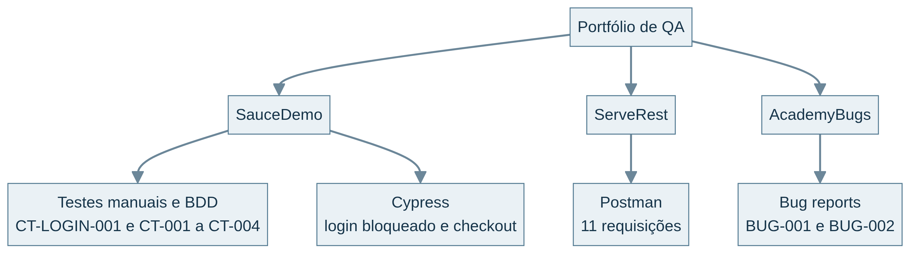

# Portfólio de Engenharia de Qualidade de Software

Este repositório reúne exercícios práticos de qualidade de software. O foco é compreender requisitos, planejar cenários de teste, executar verificações e registrar resultados com evidências.

Os testes de interface dos módulos 01 e 04 usam o SauceDemo. O módulo 02 reúne investigações no AcademyBugs. Os testes de API do módulo 03 usam a ServeRest.

## Apresentação visual



- [PDF com a visão geral do portfólio](apresentacao/portfolio-qa-visao-geral.pdf)
- [Mapa mental da abordagem de testes](apresentacao/diagramas/mapa-mental-testes.png) e [fonte editável](apresentacao/diagramas/mapa-mental-testes.mmd)
- [Fonte editável do esquema dos módulos](apresentacao/diagramas/estrutura-do-portfolio.mmd)

## Módulos publicados

### 01. Testes manuais e BDD

Cenários de login, carrinho e checkout descritos em Gherkin, acompanhados por relatórios e capturas de execução.

- [Feature de login com usuário bloqueado](01-testes-manuais-e-bdd/login-locked-user-bdd.feature)
- [Feature de carrinho e checkout](01-testes-manuais-e-bdd/carrinho-e-checkout-bdd.feature)
- [Plano de testes do portfólio](01-testes-manuais-e-bdd/plano-de-testes.md)
- [Relatório de execução do login](01-testes-manuais-e-bdd/relatorio-execucao-login.md)
- [Relatório de execução do checkout](01-testes-manuais-e-bdd/relatorio-execucao-checkout.md)

Os arquivos Gherkin documentam comportamentos. Os cenários em Gherkin descrevem os comportamentos e critérios documentados nos relatórios de execução.

### 02. Bug reports e investigação

Investigações de defeitos em exercícios do AcademyBugs, com passos para reprodução, resultados esperados e observados, evidências visuais e observações do Network.

- [README do módulo de bug reports](02-bug-reports/README.md)
- [Relatório BUG-001: busca de produto e página 404](02-bug-reports/BUG-001-busca-produto-404.md)
- [Relatório BUG-002: reserva sem confirmação visível](02-bug-reports/BUG-002-reserva.md)

### 03. Testes de API com Postman

Coleção importável para autenticação, cadastro de usuários, validações de dados e operações CRUD de produtos.

- [README do módulo API e Postman](03-testes-api-postman/README.md)
- [Coleção Postman Collection v2.1](03-testes-api-postman/Serverest-API-Tests.postman_collection.json)
- [Feature de cadastro na ServeRest](03-testes-api-postman/bdd/cadastro-usuario-bdd.feature)

### 04. Automação web com Cypress

Testes de interface com JavaScript e Cypress para login com usuário bloqueado e checkout.

- [README do módulo Cypress](04-automacao-cypress/README.md)
- [Plano de automação Cypress](04-automacao-cypress/plano-de-automacao.md)
- [Teste Cypress de login bloqueado](04-automacao-cypress/cypress/e2e/login-locked-user.cy.js)
- [Teste Cypress de checkout](04-automacao-cypress/cypress/e2e/checkout.cy.js)

A integração com GitHub Actions fica para uma etapa futura. Por enquanto, o foco é entender e validar os planos e a execução local dos testes.

Para instalar as dependências e executar os testes, use o terminal na pasta `04-automacao-cypress`:

```bash
npm ci
npm test
```

## Escopo e evidências

Os módulos de testes manuais, bug reports, API e automação estão organizados em suas respectivas pastas. Consulte o README de cada módulo para encontrar os casos, instruções e evidências. Os resultados registrados correspondem às execuções descritas nos relatórios e podem mudar se os sites de demonstração forem atualizados.
